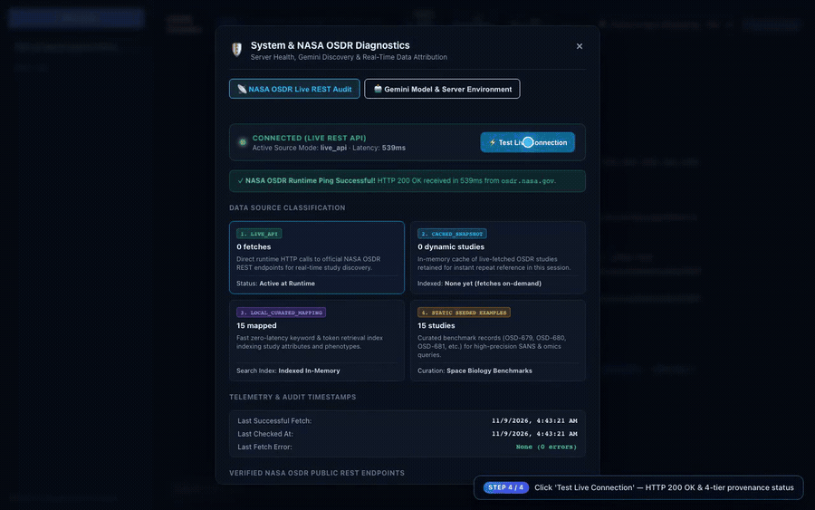

# OSDR ChatBot

**An evidence-grounded NASA Open Science Data Repository (OSDR) research assistant for live study discovery, Analysis Working Group (AWG) multi-omics comparisons, scoped study UI inspection, and provenance-audited scientific media.**

[](https://osdr-chatbot-kappa.vercel.app/)
[](LICENSE)
[](#repository-structure)
[](#api-reference)
[](#data--provenance)

---

## Quick Start in Your Browser (No Coding or Setup Needed)

Open **[osdr-chatbot-kappa.vercel.app](https://osdr-chatbot-kappa.vercel.app/)** directly in your browser to explore NASA OSDR studies without installing anything:

1. **Ask questions in plain English:** Try *"What ocular findings and assays are in OSD-255 and OSD-557?"* — study citations link directly to the official `osdr.nasa.gov` records.
2. **Pick studies visually (`/awg`):** Type `/awg` to open the Guided Chooser, switch between curated retinal/SANS cohorts and full OSDR repository search, and launch any pair.
3. **Inspect side-by-side comparisons (`/awg compare OSD-583 OSD-255`):** Review four separated tabs — **Verified Metadata** (organism, tissue, assay), **Observed Results** (peer-reviewed paper findings with DOIs), **Interpretation & Hypotheses** (clearly labeled as conceptual synthesis), and **Compatibility Breakdown** (`0–100`).
4. **Spot dataset guardrails before modeling:** Cross-mission pairs like `/awg compare OSD-255 OSD-685` automatically highlight cautions (**Zero Shared Animals** across missions, small-cohort `p >> n` split rules, `CC1`/`CC2` batch controls, and spatial coordinate alignment) and provide a **Copy Schema Contract JSON** button for your ML/data teammates.

---

## Feature Walkthrough Video

https://github.com/user-attachments/assets/7ae5a0a6-df28-48e2-8140-9e4a7a867cd1

> **Full HD Walkthrough (`3m 43s` · `1280×800`):** [**Download `docs/media/osdr-chatbot-demo.mp4`**](docs/media/osdr-chatbot-demo.mp4)

[](docs/media/osdr-chatbot-demo.mp4)

### Walkthrough Chapters

| Timestamp | Feature Demonstrated | Key Highlights |
|---|---|---|
| `0:00 – 0:27` | **Grounded OSDR Q&A & Live REST Diagnostics** | Prompting on `STS-135` mouse retina (`OSD-87`), inspecting clickable `osdr.nasa.gov` chips, and running **Test Live Connection** (`HTTP 200 OK` across 4 data tiers) |
| `0:27 – 1:15` | **AWG Guided Chooser & 3-Tier Evidence Audit** | Running `/awg`, switching `Contextual Studies` ↔ `Broader Repository Search`, comparing `OSD-583 × OSD-557`, and auditing all 4 Evidence Audit tabs + `100/100` Compatibility Breakdown |
| `1:15 – 2:16` | **Visual Gallery, Zoom Modal & 60fps Motion Players** | Comparing `OSD-679` (`OCT/IOP`) × `OSD-680` (`Optic-Nerve MRI`), stepping through 4 downloadable study diagrams, scrubbing the `5s Motion Brief`, and toggling perspectives in `Relatable Translational Clip` |
| `2:16 – 2:36` | **Scoped Gemini Computer Use Study Inspector** | Running the `osdr.nasa.gov`-allowlisted inspector on `OSD-680`, verifying the 4-step domain audit trail and 7 extracted OSDR metadata attributes |
| `2:36 – 3:43` | **AWG Meme Outreach & Session Provenance Registry** | Running `/awg meme OSD-100 OSD-194`, playing the 60fps conceptual preview canvas, reviewing evidence separation, and filtering SHA-256 provenance records in `/awg media audit` |

---

## Core Capabilities

- **Evidence-Grounded Space Biology Chat (`POST /api/chat`)**: Streams SSE responses grounded in NASA OSDR accessions (`OSD-*`) with clickable study citation pills linking directly to `osdr.nasa.gov`. Supports multi-provider resilience across Gemini (`gemini-4-argon`, `gemini-3.7-flash`, `gemini-2.5-flash`), OpenRouter, Groq, and a deterministic offline fallback engine.
- **AWG Guided Chooser & Cross-Study Co-Analysis (`/awg`, `/awg compare`, `/awg random`)**: Ranks compatible study pairs across organism, tissue, assay platform, mission factor, and publication coverage using a transparent **0–100 compatibility rubric**.
- **OSDR Release Radar & AWG Lead Watch (`/awg radar` & Header Button)**: Dual-tab studio tracking latest monthly/quarterly NASA OSDR (`cgene` + `alsda`) depositions alongside strict space-biology-scoped Pre-OSDR preprints and publications from all **9 GeneLab AWG Subgroup Chairs + Ryan T. Scott** (via ORCID Public API, OpenAlex Verified-ORCID Works, Europe PMC, and NASA OSDR Search API).
- **Strict Accession Validation, Schema Guardrails & 4-Tab Evidence Audit**: Prevents silent substitution of invalid/single/duplicate accessions, classifies outputs cleanly into **Verified Metadata**, DOI-backed **Observed Results**, **Interpretation & Hypotheses** (with explicit `Epistemic Limit` warnings), and **Compatibility Breakdown**, surfaces automated **Cross-Mission (`ZERO_SHARED_ANIMALS`), `p >> n` Animal-Disjoint CV (`P_GT_N_ANIMAL_DISJOINT`), `CC1`/`CC2` Batch (`COHORT_BATCH_CONTROLS`), Frozen Discovery Panel (`FROZEN_PANEL_FDR_GUARDRAIL`), and Spatial ROI Alignment (`SPATIAL_ALIGNMENT`)** guardrails, and provides a one-click **Copy Schema Contract JSON** export for downstream ingestion pipelines.
- **Community Contributor Hub & Ingestion Intake Portal (`/contributors` & `GET /api/awg/integrations`)**: Dedicated discovery-to-downstream portal featuring **Lissandra Kruse Fuganti (`fuganti`)**'s [`RetinaCellTwin`](https://retina-cell-twin-osdr.fuganti.chatgpt.site/) prototype with 1-click **Export Aligned Schema Contract JSON** (`OSD-255 × OSD-758`, `OSD-255 × OSD-203`, `OSD-557 × OSD-568`) plus a zero-backend **Submission & Intake Tool** (`contributor_manifest.json` download/copy, GitHub PR block & forum announcement formatters, and `localStorage` showcase preview).
- **3-Mode Grounded Media Suite**:
  - **4-Panel Visual Gallery**: Infographics, histology/pathway diagrams, narrative context scenes, and comparative study profiles (with SVG/PNG export and full-screen lightbox).
  - **5s Scientific Motion Brief**: 3-scene 60fps HTML5 canvas kinetic explainer with scene scrubbing and snapshot export.
  - **Relatable Translational Clip & Meme Outreach**: Mission-facing analogies with live perspective switching (`OCT Retinal Scan`, `HDT Analog Lab`, `Crew Health`, `Ground vs Flight`) and strict fact-vs-framing boundaries.
- **Media Generation Audit & Provenance Registry (`/awg media audit`)**: Session-wide filterable audit log tracking provider, model tier, generation status (`fresh_provider`, `cache_hit`, `fallback`, `failed`), latency, and SHA-256 prompt fingerprints.
- **Scoped Gemini Computer Use (`POST /api/computer-use`)**: Allowlist-enforced (`osdr.nasa.gov`, `nasa.gov`, `ncbi.nlm.nih.gov`) step-by-step study page inspection with structured metadata extraction.
- **Diagnostics & Text-to-Speech (`GET /api/osdr/diagnostics`, `POST /api/tts`)**: Live NASA OSDR round-trip latency testing plus provider-agnostic spoken audio playback (`Gemini 2.5 Flash TTS` / `OpenAI TTS`).

---

## Scientific Epistemic Boundary

> [!IMPORTANT]
> **OSDR_Chatbot is a research-support and scientific communication tool.** Generated diagrams, motion briefs, translational clips, and synthetic hypotheses are conceptual visualizations built on repository metadata—they are **not** raw sequencing/imaging telemetry, clinical guidance, or validated medical countermeasures.

---

## Architecture

```text
┌─────────────────────────────────────────────────────────────────────────────┐
│                                 BROWSER UI                                  │
│  React 18 + Vite SPA · SSE Chat Stream · Media Gallery & 60fps Players      │
│  4-Tab Evidence Audit · Provenance Registry · Live OSDR Diagnostics         │
└──────────────────────────────────────┬──────────────────────────────────────┘
                                       │ HTTP / REST / SSE
                                       ▼
┌─────────────────────────────────────────────────────────────────────────────┐
│                           EXPRESS API & VERCEL EDGE                         │
│     server/app.ts · api/index.ts (Serverless Adapter) · Key Isolation       │
└──────────────┬───────────────────────┬──────────────────────┬───────────────┘
               │                       │                      │
               ▼                       ▼                      ▼
┌──────────────────────┐ ┌─────────────────────────┐ ┌────────────────────────┐
│   OSDR DATA & RAG    │ │  AWG SCORING & VALIDATE │ │ MEDIA, TTS & INSPECTOR │
│ • Live OSDR REST API │ │ • Strict Pair Validator │ │ • Nano Banana / Veo    │
│ • Session Snapshot   │ │ • 100-Pt Rubric Engine  │ │ • 60fps Canvas Engines │
│ • Curated Mappings   │ │ • 3-Tier Evidence Map   │ │ • SHA-256 Audit Log    │
│ • Seeded Fallbacks   │ │ • Grounded Meme Engine  │ │ • Scoped Computer Use  │
└──────────────────────┘ └─────────────────────────┘ └────────────────────────┘
```

---

## Repository Structure

```text
OSDR_Chatbot/
├── .github/workflows/
│   └── radar-sync.yml           # Weekly GitHub Action syncing NASA OSDR & AWG Lead Radar
├── api/                         # Vercel serverless adapter & bundled handler
│   ├── index.ts                 # Serverless request entry & degraded-mode guard
│   └── serverless.js            # Esbuild ESM output consumed by vercel.json
├── docs/                        # Reference documentation & walkthrough media
│   ├── media/
│   │   ├── osdr-chatbot-demo.mp4
│   │   ├── osdr-chatbot-preview.gif
│   │   └── osdr-chatbot-poster.png
│   ├── AWG_COMMANDS.md          # Complete /awg command & evidence-tier guide
│   └── GEMINI_CAPABILITIES.md   # Model registry, routing & quota guardrails
├── paper/                       # JOSS manuscript draft & bibliography
│   ├── paper.md                 # Software paper draft (Summary, Statement of Need, Architecture)
│   └── paper.bib                # Verified NASA OSDR & SANS references
├── scripts/
│   └── syncRadarSnapshot.ts     # CLI snapshot refresher for Release Radar
├── server/                      # Backend domain services (Express + TypeScript)
│   ├── app.ts                   # REST & SSE API router
│   ├── accessionValidator.ts    # Strict accession parsing & anti-substitution rules
│   ├── awg.ts                   # AWG command parser, compatibility scorer & evidence map
│   ├── communityIntegrations.ts # Collaborator prototype showcase & schema handshakes
│   ├── computerUse.ts           # Domain-allowlisted OSDR DOM/schema inspector
│   ├── env.ts                   # Server-only secret/environment isolation
│   ├── gemini.ts                # Streaming Gemini chat & system instruction synthesis
│   ├── mediaGen.ts              # Image/video generation, Veo circuit breaker & audit log
│   ├── memeGen.ts               # Metadata-grounded scientific outreach generator
│   ├── memeMarkdown.ts          # Safe Markdown serialization for outreach cards
│   ├── modelCapabilities.ts     # Centralized Gemini 4 Argon / Nano Banana / Veo router
│   ├── modelDiscovery.ts        # Live model discovery & error classification
│   ├── osdrClient.ts            # Live NASA OSDR API client & 4-tier provenance tracker
│   ├── radar.ts                 # Release Radar aggregator, ORCID/OpenAlex lead watch & scope filter
│   ├── radarSnapshot.json       # Pre-synced snapshot of OSDR releases & scoped lead signals
│   ├── rag.ts                   # Hybrid retrieval & OSDR prompt context assembly
│   ├── studiesData.ts           # Indexed space-biology dataset metadata
│   ├── studyManifests.ts        # Curated DOIs, observed outcomes & epistemic cautions
│   ├── textProviders.ts         # Multi-provider LLM cascade (Gemini -> OpenRouter -> Groq)
│   └── tts.ts                   # Provider-agnostic TTS WAV synthesis
├── src/                         # Frontend SPA (React 18 + Vite)
│   ├── components/
│   │   ├── audit/               # AccessionValidationCard, EvidenceAuditCard, MediaAuditCard, MediaProvenanceBadge
│   │   ├── awg/                 # AwgGuidedChooser, AwgMediaGallery, AwgMemeCard, AwgRadarInlineCard, CommunityIntegrationsModal, ReleaseRadarModal, RelatableClipPlayer, StudyBriefVideoPlayer, VisualAbstractCard
│   │   ├── chat/                # Message, Sidebar, TtsPlayButton
│   │   └── system/              # ComputerUsePanel, ErrorBoundary, LicenseHudOverlay, OsdrDiagnosticsModal
│   ├── hooks/
│   │   └── useConversations.js  # Local conversation state persistence
│   ├── App.jsx                  # Application layout, streaming orchestrator & header controls
│   ├── api.js                   # Typed frontend fetch/SSE helpers
│   ├── main.jsx                 # React root & ErrorBoundary mount
│   └── styles.css               # Unified dark scientific theme stylesheet
├── tests/                       # Automated verification suite (13 deterministic modules via tsx)
├── CONTRIBUTING.md              # Contributor workflow, epistemic rules & zero-key test guide
├── LICENSE                      # OSI-approved MIT License
├── server.ts                    # Local Node/Vite development & production entry point
├── package.json                 # Build, dev, lint/typecheck, and test scripts
├── tsconfig.json                # TypeScript compiler config (src, server, tests)
├── vite.config.ts               # Vite frontend bundler configuration
└── vercel.json                  # Vercel SPA & /api/(.*) serverless rewrites
```

---

## AWG Commands & Data Provenance

See [`docs/AWG_COMMANDS.md`](docs/AWG_COMMANDS.md) for detailed workflows and [`docs/GEMINI_CAPABILITIES.md`](docs/GEMINI_CAPABILITIES.md) for capability routing and rate-limit policies.

| Command | Purpose | Example |
|---|---|---|
| `/awg` | Launch interactive Guided Study Chooser & repository search | `/awg` |
| `/awg radar` | Open **OSDR Release Radar** digest covering monthly/quarterly `cgene`+`alsda` releases & 9 AWG Leads Pre-OSDR watch | `/awg radar leads` |
| `/awg compare <A> <B>` | Dual-accession evidence audit, compatibility breakdown & visual media | `/awg compare OSD-679 OSD-680` |
| `/awg random` | Roll a verified high-compatibility pair | `/awg random` |
| `/awg meme <A> <B>` | Generate outreach clip with conceptual vs. empirical boundary | `/awg meme OSD-100 OSD-194` |
| `/awg media audit` | Inspect all session media outputs & SHA-256 provenance records | `/awg media audit` |
| `/awg help` | View command help & epistemic rules in chat | `/awg help` |

### 4-Tier Data Resolution Hierarchy

1. **`live_api`** — Real-time HTTP queries against `osdr.nasa.gov/osdr/data/search`, `/osd/meta`, and `/osd/files`.
2. **`cached_snapshot`** — Session-cached accession records fetched dynamically during runtime.
3. **`local_curated_mapping`** — Verified space biology metadata & multi-omics assay cross-references.
4. **`static_seeded_examples`** — Resilient offline benchmark cohorts (`OSD-583`, `OSD-255`, `OSD-557`, `OSD-568`, `OSD-758`, `OSD-759`, `OSD-203`, `OSD-685`, `OSD-698`, `OSD-679`, `OSD-680`, `OSD-681`, `OSD-100`, `OSD-194`, `OSD-87`).

---

## Setup & Development

### Prerequisites

- **Node.js** `>= 18`
- **npm** `>= 9`

### Environment Variables

Create a `.env` file from [`.env.example`](.env.example). All keys remain isolated on the backend Node.js runtime and are never bundled into client JavaScript.

| Variable | Required? | Description |
|---|---|---|
| `GEMINI_API_KEY` | Recommended | Enables Gemini chat streaming, image/video capability discovery, Computer Use & Gemini TTS |
| `GEMINI_TEXT_MODEL` | Optional | Default chat model (`gemini-4-argon`, `gemini-3.7-flash`, or `gemini-2.5-flash`) |
| `OPENROUTER_API_KEY` | Optional | Automatic fallback text provider when Gemini is rate-limited (`429`) or unavailable |
| `GROQ_API_KEY` | Optional | Tertiary fallback text provider in the cascade |
| `OPENAI_API_KEY` | Optional | Alternate TTS backend (`tts-1` / `alloy`) for response audio playback |

### Install, Run & Verify

```bash
# Install dependencies
npm install

# Start development server (Express API + Vite HMR on http://localhost:3000)
npm run dev

# Typecheck TypeScript (src, server, tests)
npm run lint

# Build production SPA + Express server + Vercel serverless bundle
npm run build

# Run full automated test suite (13 integration & unit test files)
npm test

# Start built production server
npm run start
```

### Zero-API-Key Verification (Reviewers & Offline Environments)

All **13 automated test suites** under [`tests/`](tests/), strict TypeScript compilation, and production builds run cleanly **without setting `GEMINI_API_KEY`, `OPENROUTER_API_KEY`, `GROQ_API_KEY`, or `OPENAI_API_KEY`**:

```bash
# Run without any .env file or external LLM credentials
npm install
npm run lint
npm test
npm run build
```

You can also launch `npm run dev` on `http://localhost:3000` with no `.env` file present: the chat API automatically engages its deterministic metadata-grounded fallback engine (`local_deterministic`), and `/awg`, `/awg radar`, `/awg compare <A> <B>`, **Schema Contract JSON** export, 60fps canvas motion players, and `/awg media audit` remain fully functional using curated manifests (`server/studyManifests.ts`) and the bundled Release Radar snapshot (`server/radarSnapshot.json`). See [`CONTRIBUTING.md`](CONTRIBUTING.md) for detailed reviewer verification steps.

---

## API Reference

All endpoints are served under `/api/*` via `server/app.ts` (and routed to `api/serverless.js` in Vercel deployments).

| Method | Endpoint | Description |
|---|---|---|
| `GET` | `/api/health` | Fast deployment health & key presence check |
| `GET` | `/api/diagnostics` | Full system, model discovery & OSDR connectivity telemetry |
| `GET` | `/api/models` | Lists available text chat models & default model ID |
| `GET` | `/api/studies` | Lists indexed & cached OSDR studies |
| `GET` | `/api/study/:study_id` | Fetch single study metadata (queries live OSDR if uncached) |
| `GET` | `/api/search` | Fast local tokenized search across indexed datasets |
| `GET` | `/api/osdr/diagnostics` | OSDR provenance tier counts & request telemetry |
| `POST` | `/api/osdr/test-connection` | Live HTTP ping against `osdr.nasa.gov` |
| `GET` | `/api/osdr/search-live` | Live search proxy to NASA OSDR Search API |
| `POST` | `/api/chat` | SSE streaming chat & `/awg` synthesis endpoint |
| `GET` | `/api/awg/suggestions` | Curated high-compatibility study pairings |
| `GET` | `/api/awg/random-pair` | Select a random compatible study pair |
| `GET` | `/api/awg/compatibility` | Compute 100-point compatibility breakdown (`?studyA=...&studyB=...`) |
| `GET` | `/api/awg/integrations` | Community collaborator demonstrators (e.g., `RetinaCellTwin`) & Schema Contract handshakes |
| `GET` | `/api/awg/radar` | Query monthly/quarterly OSDR releases & scoped AWG Lead signals (`?window=...&subgroup=...&leadId=...`) |
| `POST` | `/api/awg/radar/refresh` | Trigger live refresh from NASA OSDR, ORCID, OpenAlex & Europe PMC (`{ force: true }`) |
| `POST` | `/api/awg/media-set` | Generate 4-part grounded AWG image gallery |
| `POST` | `/api/awg/video` | Generate 3-scene scientific motion brief |
| `POST` | `/api/awg/translational-clip` | Generate grounded relatable translational clip |
| `POST` | `/api/awg/meme` | Generate grounded outreach meme concept |
| `GET` | `/api/awg/media/audit` | Retrieve session media generation audit & SHA-256 registry |
| `POST` | `/api/computer-use` | Execute allowlisted OSDR study inspection step log |
| `GET` | `/api/capabilities` | Return centralized Gemini capability registry & labels |
| `GET` / `POST` | `/api/tts/status`, `/api/tts` | Check TTS providers and synthesize WAV audio |

---

## Deployment & Security

- **Live Deployment:** https://osdr-chatbot-kappa.vercel.app/
- **Server-Side Isolation:** Credentials reside strictly in Node memory (`server/env.ts`) and are excluded via `.gitignore` (`.env`, `.env.*`, `*.pem`, `*.key`, `credentials.json`).

---

## Contributing, License & Citation

- **Author & Profiles:** Gaston Dana · [ORCID (`0009-0007-1011-860X`)](https://orcid.org/0009-0007-1011-860X) · [Google Scholar (`juOv0f0AAAAJ`)](https://scholar.google.com/citations?user=juOv0f0AAAAJ&hl=en) (also accessible via the live corner **MIT License HUD Overlay**)
- **Contributing:** See [`CONTRIBUTING.md`](CONTRIBUTING.md) for epistemic provenance rules, zero-key verification commands, and pull request workflow.
- **License:** Released under the OSI-approved [**MIT License**](LICENSE).
- **Software Paper Draft:** A Journal of Open Source Software (JOSS) manuscript draft and verified reference list live in [`paper/paper.md`](paper/paper.md) and [`paper/paper.bib`](paper/paper.bib).

---

## Attribution & Disclaimer

This project integrates publicly accessible metadata from the **[NASA Open Science Data Repository (OSDR)](https://osdr.nasa.gov/)**. Community research modules featured in **Integrations**—such as [**RetinaCellTwin**](https://retina-cell-twin-osdr.fuganti.chatgpt.site/) by **Lissandra (`fuganti`)**—are independent collaborator demonstrators attributed to their respective creators. `OSDR_Chatbot` is an independent open-source research-support tool and is **not officially affiliated with, endorsed by, or sponsored by NASA**.
